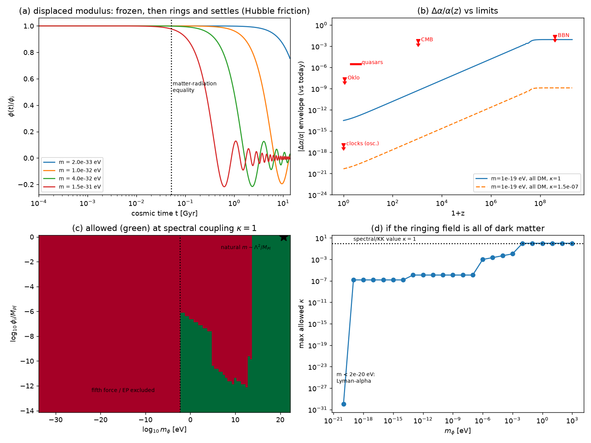

# 65. "A stone thrown into a still pond": a displaced internal modulus that rings and settles (exploratory)

**Date:** 23 November 2026 (America/Chicago)
**Status:** exploratory. The **Dual-Zero regulator is untouched**: nothing here uses or changes \(\varepsilon(n)=\omega_0(-1)^nn^{-n}\) or \(\operatorname{Reg}_2\).
**Code:** `experiments/two_loop_pati_salam/ripple_modulus.py` and `report_65.py`. Numbers are in `results_doc65.json` (~10 s).
**Figure:** `experiments/two_loop_pati_salam/fig_doc65_ripple_settle.png`, copied to `docs/hardening/figures/65_ripple_settle.png`.
**Tests:** `tests/test_ripple_modulus.py` (10 tests).

> **On the source.** Shawn's picture is that creation was like a stone thrown into a still pond: the universe rippled and is settling back to stillness. That picture is the inspiration only. It is turned into a definite model below: a displaced modulus with Hubble-damped oscillations. The model is judged against data like everything else in this series.

---

## Plain-language summary (for Shawn)

- **Does "ripple then settle" pass?** Yes, but only in one regime, and that regime leaves no trace we can see today.
  - The size of the internal space starts displaced and then rings. Hubble friction damps the ringing (amplitude ∝ a^{-3/2}), so the field always settles. That part is automatic.
  - **It survives with the natural coupling** (the strength the spectral action / compactification gives, κ = 1) **and a natural, order-one kick** (φ_i ~ M_Pl) **only if the field is heavy: m_φ ≳ 100 TeV.**
  - Then it dominates the early universe briefly and decays before nucleosynthesis, reheating the universe to above 5 MeV.
  - The natural estimate for a stabilized modulus, m_φ ~ Λ²/M_Pl ≈ 6×10¹¹ GeV, is deep inside this safe region. It decays after ~10⁻²² s and reheats to ~10⁸ GeV.
  - The ripple is gone long before atoms exist, so **it predicts no variation of α or of masses that we could measure.**
- **The spectral action itself gives no potential.** After the change to the standard (Einstein) frame, the overall-scale modulus is exactly flat (Chamseddine–Connes scale invariance, checked in code). So the mass m_φ is not derived; it has to come from somewhere else (flux, loops). A massless or light version with the natural coupling is ruled out by equivalence-principle tests:
  - η ≈ 0.25 against MICROSCOPE's 5.5×10⁻¹⁵, a factor of 4×10¹³;
  - the coupling would have to be 10⁷ times weaker than the natural value.
- **Lighter fields (below ~5 meV):** excluded at the natural coupling for every initial kick, by fifth-force and equivalence-principle tests. The strongest coupling enters through the strong force: a change in the size changes the unified coupling, and that moves the proton mass about 40 times more than α.
- **Medium masses (5 meV to ~10 TeV) at the natural coupling:** these work only if the initial kick is tiny, φ_i ≲ 10⁻⁶ to 10⁻¹² M_Pl. Otherwise the leftover field overcloses the universe or decays too late and spoils nucleosynthesis or the CMB. That is the classic "cosmological moduli problem".
- **Could the ringing field be dark matter?** Yes, in two windows:
  - **0.01 eV ≲ m_φ ≲ ~1 keV** with the natural coupling. It needs a fine-tuned small kick, φ_i ~ 10⁻⁶–10⁻⁸ M_Pl. Its α oscillation is ~10⁻³⁰, far below any experiment.
  - **2×10⁻²⁰ ≲ m_φ ≲ 10⁻³ eV** with a coupling 10³–10⁷ times weaker than natural. This is the window where atomic clocks and the equivalence-principle tests look for an oscillating α. A detection there would be a "ringing pond", but nothing in the framework fixes that weak coupling.
- **Top/Higgs: no help.** The masses are measured today, after the settling. In the spectral action, the boundary values y_t(Λ) and λ(Λ) are ratios fixed by traces of the finite Dirac operator. They move together with the gauge coupling, so the settled size cancels out. The settled value is itself fixed by today's measured α. Moving the boundary scale by ×0.1–×3 moves M_t only from 188.8 to 191.0 GeV. **M_t = 190.36, M_h = 180.50 stand.** The model adds 3 parameters (m_φ, φ_i, κ), none of which touches the top.

---

## 1. Model

- **The field.** φ is the canonical radion of the magnetized internal surface (d = 2, as in docs 62–64). The area is \(A=A_0e^{2\sigma}\) and \(\phi=\sqrt{d(d+2)/2}\,M\sigma=2M\sigma\), where M is the reduced Planck mass, 2.435×10¹⁸ GeV.
- **The potential.** The tree-level spectral action with \(D\to e^{-\sigma}D\) has \(V_J\propto f_4\Lambda^4e^{4\sigma}\) and \(M_J^2\propto f_2\Lambda^2e^{2\sigma}\). The Einstein-frame potential \(V_E=V_J/(M_J^2/M^2)^2\) is constant (`spectral_potential_einstein`, tested), so it is flat. I use a quadratic potential \(V=\tfrac12m_\phi^2\phi^2\) with m_φ free. The natural stabilized benchmark is \(m_\phi\sim\Lambda^2/M\approx6.3\times10^{11}\) GeV, with Λ = 1.24×10¹⁵ GeV.
- **Couplings** (per unit φ/M, all multiplied by an overall strength κ; κ = 1 is the spectral/KK value):

| Quantity | Origin | Coefficient |
|---|---|---|
| Δα/α | \(1/\alpha_i(\Lambda)\propto A\) for every group ⇒ \(\delta(1/\alpha_{em})=\tfrac83\,\delta(1/\alpha_U)\) | β_α = −(8/3)α/α_U = **−0.867** |
| Δ ln(m_p/M) | Λ_QCD by dimensional transmutation (b₃ = 7) plus the universal −½ | β_p = **−40.5** |
| Δ ln(m_e/M) | y ∝ g (spectral relation); O(1), model-dependent | β_e = −0.5 |
| Δ ln μ (m_p/m_e) | | −40.0 |
| Δ ln y_t, Δ ln λ at Λ | y_t², λ ∝ g² | −0.5, −1.0 |
| Δ(y_t/g), Δ(λ/g²) | trace ratios of D_F | **0** |

- **Dynamics.** I solve \(\phi''+(3+\epsilon)\phi'+(m/H)^2\phi=0\) in N = ln a, with a realistic H(a):
  - Planck 2018: h = 0.674, Ω_m = 0.315, T₀ = 2.7255 K, N_eff = 3.046;
  - the SM g_*(T) and g_*s(T) steps;
  - the age comes out at 13.79 Gyr, and H(z=1100) = 3.4×10⁻²⁹ eV.
  
  Once m/H > 100 the solution switches to the exact adiabatic envelope (∝ a^{-3/2}); this is checked against the full ODE to < 2%. Everything is linear in φ_i.

## 2. Data used (representative 2σ limits)

| Probe | Epoch | Limit | Notes |
|---|---|---|---|
| BBN (He-4, D/H) | z ≈ 4×10⁸ | \(|\Delta\alpha/\alpha|<0.02\), \(|\Delta\ln(m_q/\Lambda_{QCD})|<0.02\), \(|\Delta\ln(Gm_p^2)|\) ↔ \(|\Delta\ln(m_p/M)|<0.05\) | averaged over ~1 s if the field oscillates faster |
| CMB (Planck) | z = 1100 | \(|\Delta\alpha/\alpha|<5\times10^{-3}\), \(|\Delta m_e/m_e|<1.4\times10^{-2}\) | averaged over the ~4×10⁴ yr recombination |
| Quasar absorbers | z = 1–4 | \(|\Delta\alpha/\alpha|<3\times10^{-6}\) | snapshot (no averaging) |
| Molecular μ | z = 0.89 | \(|\Delta\mu/\mu|<3\times10^{-7}\) | snapshot |
| Oklo | z = 0.14 | \(|\Delta\alpha/\alpha|<2\times10^{-8}\) | averaged over ~10⁵ yr |
| Atomic clocks | today | \(|\dot\alpha/\alpha|<5\times10^{-19}\)/yr (drift; period > 10 yr); oscillation amplitude < 10⁻¹⁷ (1 h – 10 yr) | |
| MICROSCOPE | range > R_⊕ | η < 5.5×10⁻¹⁵ | dilaton-charge model, Ti vs Pt |
| Eöt-Wash EP and inverse-square | 1 m – R_⊕; 50 µm – 1 m | η < 3.6×10⁻¹³, α₅ < 10⁻³; α₅ < 1 at 50 µm, ramping to 10⁻³ at 1 m | |
| Energy density | today | Ω_φh² ≤ 0.12; fuzzy DM > 10% of DM needs m > 2×10⁻²⁰ eV | |
| Late decays | 0.1 s – t₀ | ρ/s < 10⁻⁹ GeV (0.1–100 s), < 10⁻¹⁴ GeV (to 10¹² s), < 10⁻¹⁵ GeV (to t₀); decaying relic τ > 10²⁶ s | order of magnitude |
| Reheating | | T_RH > 5 MeV if φ dominates | |

Variations are measured relative to today's lab value, so the code uses \(|\phi(z)-\phi_0|\): the exact difference for a slowly rolling field, the envelope sum for an oscillating one. The decay rate is Γ ≈ κ²m³/(4πM²), uncertain at O(1).

**Fifth-force model.** The dilaton charge is \(Q_A=\beta_p+\beta_\alpha f_{EM}+(\beta_e-\beta_p)f_e\), with the Coulomb fraction f_EM from the semi-empirical mass formula. This gives η ≈ 0.25κ² and α₅ ≈ 3.3×10³κ².

## 3. Results

**Allowed region at κ = 1** (figure, panel c):

| m_φ | Largest allowed φ_i/M | What fails otherwise |
|---|---|---|
| < 5 meV | none | fifth force / EP (any φ_i) |
| 10 meV – 10 keV | 8×10⁻⁷ → 2.5×10⁻⁸ | overclosure (stable relic) |
| 100 keV – 1 TeV | 4×10⁻¹¹ → 1.2×10⁻¹² | late decay (X/γ, CMB, BBN photodissociation) |
| 10 TeV | 2×10⁻¹⁰ | BBN (decays at ~50 s) |
| **≥ 100 TeV** | **1 (any)** | — (decays before BBN; T_RH = 5.5 MeV at 100 TeV) |
| natural 6.3×10¹¹ GeV | 1 | τ = 2×10⁻²² s, T_RH ≈ 9×10⁷ GeV |

**Largest coupling if the field is all of the dark matter** (panel d):

| m_φ (eV) | φ_i/M for Ω h² = 0.12 | κ_max | Limiting test |
|---|---|---|---|
| 10⁻²⁰ | — | 0 | Lyman-α (fuzzy DM) |
| 10⁻¹⁹ – 10⁻¹⁴ | 10⁻² (at 10⁻¹⁹) | 1.5×10⁻⁷ | MICROSCOPE |
| 10⁻¹³ – 10⁻⁷ | 1.9×10⁻⁴ (at 10⁻¹²) | 1.2×10⁻⁶ | Eöt-Wash |
| 10⁻⁶ – 10⁻³ | 1.4×10⁻⁶ (at 10⁻³) | 10⁻³ – 10⁻² | short-range inverse-square |
| 10⁻² – 10³ | ≲ 10⁻⁶ | 1 | none (range < 20 µm; α oscillation ~10⁻³⁰) |

For the m = 10⁻¹⁹ eV benchmark (panel b) at κ = 1, α's oscillation envelope passes the quasar bound (~10⁻⁸ at z = 2). It fails the clocks (~10⁻¹⁴ today against 10⁻¹⁷) and fails at BBN through the strong-force coupling (Δln(m_q/Λ_QCD) ≈ 0.4). At κ_max = 1.5×10⁻⁷ the clock amplitude is 2×10⁻²¹.

**Top/Higgs** (`top_higgs`, doc 60 pipeline):

| Scenario | M_t (GeV) | M_h (GeV) |
|---|---|---|
| any settled minimum (ratios unchanged) | 190.36 | 180.50 |
| boundary at 0.1Λ / 0.3Λ / 3Λ | 188.84 / 189.59 / 191.01 | 179.46 / 179.85 / 181.22 |

Moving the boundary off the gauge-meeting scale also breaks the spectral g₂ = g₃ = g₄ condition (doc 61). The ringing at early times changes y_t and λ only together with g, and only before the settling. The low-energy masses are set by the settled values, which are fixed by today's α.

## 4. Verdict

| Question | Answer |
|---|---|
| Does a displaced modulus ring and settle? | Yes, automatically (Hubble friction; amplitude ∝ a^{-3/2}; panel a). |
| Is the potential derived from the spectral action? | No: it is exactly flat in the Einstein frame; m_φ is a free parameter. |
| Natural coupling (κ = 1) and natural kick (φ_i ~ M_Pl)? | **Passes only for m_φ ≳ 100 TeV**, which includes the natural Λ²/M_Pl ≈ 6×10¹¹ GeV. It leaves no observable remnant. |
| Light modulus with natural coupling? | Excluded for m_φ < 5 meV (EP/fifth force). 5 meV–10 TeV needs a tuned kick φ_i ≲ 10⁻⁶–10⁻¹². |
| Testable prediction? | Only in the dark-matter window with a non-natural weak coupling: a monochromatic oscillation of α (and, ~40× larger, of m_p/m_e) at frequency m_φ/2π, amplitude ∝ √ρ_DM/m_φ. The natural-parameter version predicts nothing observable. |
| Helps M_t = 190, M_h = 180? | No. Boundary ratios are independent of the settled size; 3 new parameters, 0 effect. |
| Dual-Zero | Intact. |
