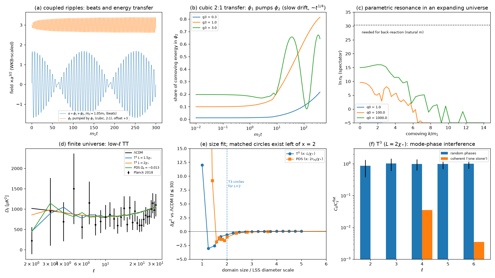

# 66. Coupled ripples and a "bounded pond": interacting moduli and a finite universe (exploratory)

**Date:** 24 November 2026 (America/Chicago)
**Status:** exploratory. The **Dual-Zero regulator is untouched**: nothing here uses or changes \(\varepsilon(n)=\omega_0(-1)^nn^{-n}\) or \(\operatorname{Reg}_2\).
**Code:**
- `experiments/two_loop_pati_salam/coupled_ripples.py` (part A);
- `finite_universe.py` (part B);
- `report_66.py`, with numbers in `results_doc66.json` (~4 min, dominated by the Mathieu scan);
- Planck 2018 spectra in `experiments/two_loop_pati_salam/data/` (PLA/IRSA R3.01 files).

**Figure:** `docs/hardening/figures/66_bounded_pond.png`, also at `experiments/two_loop_pati_salam/fig_doc66_bounded_pond.png`.
**Tests:** `tests/test_coupled_ripples_finite_universe.py` (12 tests).

> **On the imagery.** "Ripples that affect each other" and a "bounded pond" are Shawn's pictures and serve as inspiration only. Each is turned into definite equations below:
> - several moduli with couplings;
> - finite spatial topologies;
>
> and those equations are judged against data.

---

## Plain-language summary (for Shawn)

- **Ripples that affect each other (part A).** I let two internal-geometry fields interact in five ways. In every case the system still settles, because the expansion of the universe stretches the ripples out and switches the interactions off.
  - The interactions move energy between the ripples, cause beats, and can delay the settling.
  - None of them changes doc 65's verdict: a heavy natural field (≥ ~100 TeV) is fine, and a light field with the natural coupling is not.
  - **Only two things matter physically:**
    - **A light partner.** If one of the fields is much lighter than about 100 TeV, it causes the same problems as in doc 65 (moduli problem, fifth force). That happens if the second mass is below about 1.5×10⁻⁷ of the first, or if the mixing is tuned to within ~10⁻¹⁴ of the unstable point.
    - **Extra damping.** Energy loss into radiation lowers the safe mass, from 94 TeV to 9 TeV with 1000× gravitational damping.
  - **Particle production by resonance** happens only for couplings far stronger than natural. Even then it drains less than 10⁻⁶ of the energy. The gravitational waves it would make are at ~10⁷ Hz with Ω_GW h² ≲ 10⁻¹⁸, which is undetectable.
  - **Testable:** beats in α (two nearly equal masses give a 99%-contrast beat). This is visible only in doc 65's weakly-coupled dark-matter window.
- **A finite universe (part B).** I computed the large-angle CMB for a cubic 3-torus, a closed sphere, and the Poincaré dodecahedral space. I compared them with Planck 2018, whose quadrupole is low: 226 μK² against ΛCDM's 1017.
  - Small finite spaces do suppress the quadrupole. The best fits improve on ΛCDM by Δχ² = −3.1 (torus) and −1.9 (dodecahedron). That is less than 2σ for one extra parameter, and below 1σ after accounting for trying three shapes.
  - **Both best fits are ruled out:** at those sizes the universe would show matched circles in the CMB, and Planck found none. The dodecahedral fit also needs Ω_k ≈ −0.016, which is 9σ away from Planck+BAO.
  - The allowed versions (no circles) improve the fit by at most Δχ² = −1.0. Inside Planck+BAO's curvature range the improvement is about −0.01, i.e. nothing.
- **Mode phases.** If every mode of the finite space started with the same phase (one coherent "stone"), the sky would be cube-symmetric around us. The quadrupole and all odd multipoles would vanish exactly. Planck measures D₃ = 937 μK² and D₅ = 1502 μK², so that is excluded. With random phases the result is the usual average.
- **Top and Higgs:** unaffected, M_t = 190.36 GeV and M_h = 180.50 GeV. Neither moduli couplings nor spatial topology enter the finite-space traces that set them.

---

## Part A: coupled multi-ripple moduli

**Model.** Time is τ = m₁t and fields are in units of M_Pl, in the radiation era:

\[V=\tfrac12\phi_1^2+\tfrac12\mu^2\phi_2^2+\varepsilon\mu\phi_1\phi_2+\tfrac{g_3}{2}\phi_1^2\phi_2+\tfrac{\lambda}{4}\phi_1^2\phi_2^2,\qquad
\ddot\phi_i+\Big(\tfrac{3}{2\tau}+\Gamma\Big)\dot\phi_i+\partial_iV=0.\]

- φ₁ is the radion and φ₂ a shape modulus. Both are flat directions of the tree-level spectral action (doc 65), so every coefficient here is free.
- **Settle time** is when the period-averaged comoving energy (a³ρ) of the slowest eigenmode stays within 5% of its final value.
- **Physical scale:** for the natural m₁ ≈ Λ²/M_Pl = 6.3×10¹¹ GeV, one unit of τ is 1.0×10⁻³⁶ s.
- Doc 65's constraints are applied to the lightest eigenmode.

| # | Variation | Parameters | Slowest-mode settle (units 1/m₁) | Interaction effect | Doc 65 constraints | Observable |
|---|---|---|---|---|---|---|
| 1 | Linear mixing, weak | ε = 0.1, 0.5 (μ = 1.3) | 5.7, 7.2 | 14%, 9% energy sloshing between flavour fields; beat period 19.6, 9.5 | unchanged (m_light = 0.99, 0.78 m₁) | none at natural m |
| 1 | Linear mixing, strong | ε = 0.9, 0.99, 0.9999 | 16, 50, 506 (≈ 5.7/m_light) | light eigenmode m_light = 0.35, 0.11, 0.011 m₁ | unchanged unless 1−ε ≲ 2×10⁻¹⁴ (then m_light < 94 TeV, moduli problem); ε ≥ 1 is tachyonic (runaway) | — |
| 2 | Cubic, 2:1 resonant (μ = 2) | g₃ = 0.3, 1, 3 | total energy 5.6, 5.8, 7.2; the φ₁↔φ₂ split keeps drifting slowly through the run (τ = 400) | φ₁ pumps φ₂: late φ₂ share 19%, 78%, 60% (linear: 0.014%); comoving energy ×1.00, 1.06, 2.05 | unchanged (both modes heavy) | none at natural m |
| 2 | Quartic, 1:1 | λ = 1, 10, 100 | 5.6 (unchanged) | no transfer (< 10⁻⁴) | unchanged | — |
| 2 | Large cubic, both displaced | g₃ = 3, φ₂(0) = 1 | — | potential unbounded below: runaway (decompactification) | excluded as a vacuum | — |
| 3 | Parametric resonance, spectator χ (g²φ₁²χ²) | q₀ = 0.1, 1, 10, 100, 1000 | unchanged | ln n_max = 0, 0, 0.7, 9.6, 16.0; back-reaction needs ln n ≈ 30.3 | unchanged: drained energy ≤ 6×10⁻⁷ | GW f₀ ~ 3×10⁷ Hz, Ω_GW h² ≲ 10⁻¹⁸ (undetectable) |
| 4 | Back-reaction / dissipation into radiation | Γ = c·Γ_grav, c = 1, 10, 10³, 10⁶ | ~1/Γ | Γ = 0.01 m₁ leaves 5.7% of the comoving energy by τ = 300 | **safe-mass floor moves 94 → 44 → 9.4 → 0.94 TeV** | none (field gone before BBN) |
| 5 | Degenerate masses | μ = 1.01, 1.05 | 5.6 | α ∝ φ₁+φ₂ beats with **99% contrast**, period 628, 126 | unchanged | α beats at Δm (visible only in doc 65's weak-coupling DM window) |
| 5 | Hierarchical masses | μ = 10⁻², 10⁻⁶, 10⁻¹², 10⁻³⁰ | 50, 5×10⁵, 5×10¹¹, 5×10²⁹ | light partner holds O(1) of the displacement | allowed for μ ≥ **1.5×10⁻⁷** (m₂ ≥ 94 TeV); μ = 10⁻¹² fails (moduli problem); 10⁻³⁰ fails (EP + overclosure) | a light partner is doc 65's dark-matter or fifth-force case |

**Why the interactions switch off.** The amplitudes fall as a^{-3/2}, so cubic and quartic terms fall faster than the mass terms (∝ a^{-3/2} and a^{-3} relative to them). Energy exchange is fast only in the first few oscillations. At exact 2:1 tuning the split between the two heavy modes keeps drifting slowly: the accumulated transfer grows only as ∫A dτ ∝ τ^{1/4} in radiation and logarithmically in matter. The total comoving energy, the quantity that matters for doc 65, has settled by τ ≈ 6–7. Resonance in an expanding universe is cut off because q ∝ a^{-3}. Natural (gravitational-strength) couplings give q ≲ 1, which means no particle production at all.

## Part B: a finite ("bounded") universe and the large-angle CMB

**Method** (Sachs–Wolfe, ensemble average over Gaussian mode amplitudes; ratios R_ℓ applied to the Planck 2018 best-fit ΛCDM D_ℓ):
- **T³** (cube of side L): discrete modes k = 2π|n|/L.
- **S³**: hyperspherical modes β ≥ 3 with normalized Gegenbauer radial functions and P ∝ 1/(β(β²−1)).
- **Poincaré dodecahedral space (PDS) = S³/I\*.** I\* is the binary icosahedral group of order 120. Level β = k+1 keeps the fraction d_j/(2j+1) of its modes, with d_j taken from the Molien series (1+t³⁰)/((1−t¹²)(1−t²⁰)). The allowed β are 1, 13, 21, 25, 31, 33, … A Clebsch–Gordan identity shows this fraction is the same in every ℓ.
- **Flat-space limits** are reproduced to < 2×10⁻³ (tested).
- **Likelihood:** full-sky inverse-gamma (cosmic variance), f_sky = 0.94, ℓ = 2–30.
- **Approximation:** ISW and Doppler terms are scaled with the same R_ℓ.

**Data:**
- Planck 2018 Commander: D₂ = 225.9 μK² (ΛCDM 1016.7).
- Full-sky S₁/₂ from the spectrum (ℓ ≤ 100): 6,777 μK⁴, against 34,518 for ΛCDM. The masked-sky S₁/₂ is lower still and is not used here.

| Model | Size | R₂ = C₂/C₂^ΛCDM | Δχ² (ℓ ≤ 30) | S₁/₂ (μK⁴) | Matched circles? | Curvature vs Planck+BAO | Verdict |
|---|---|---|---|---|---|---|---|
| ΛCDM (infinite flat) | — | 1 | 0 | 34,518 | — | — | reference |
| T³ best fit | L = 1.25 χ* | 0.21 | **−3.06** | 1,477 | **yes** (L < 2χ*) | flat | excluded by circle searches |
| T³ smallest without circles | L = 2.0 χ* | 0.84 | −0.60 | 23,971 | no | flat | allowed, negligible gain |
| T³ | L ≥ 3 χ* | ≥ 0.98 | > −0.03 | ≈ ΛCDM | no | flat | indistinguishable |
| S³ (no topology) | Ω_k = −0.005 … −0.044 | 1.000 | < 0.06 | ≈ ΛCDM | — | — | no effect at low ℓ |
| PDS best fit | Ω_k = −0.016 | 0.16 | **−1.89** | 7,134 (≈ data) | **yes** (χ* > π/10) | −8.8σ | excluded (circles + curvature) |
| PDS (Luminet-type) | Ω_k = −0.013 | 0.44 | −1.41 | 10,450 | yes | −7.2σ | excluded |
| PDS largest without circles | Ω_k = −0.0099 | 0.77 | −1.01 | 19,943 | no | −5.6σ | excluded by curvature |
| PDS within Planck+BAO 2σ | Ω_k ≥ −0.003 | ≥ 0.99 | ≈ −0.01 | ≈ ΛCDM | no | ✓ | allowed, no effect |

**Honest significance.**
- The best improvement, Δχ² = −3.1 for one extra parameter, is a ~1.7σ local preference.
- I scanned three topologies plus a size, so after look-elsewhere it is < 1σ.
- Every configuration that produces it is excluded independently: matched circles were not found by Cornish et al. 2004 or Planck 2015 XVIII, and the curvature conflicts with Planck+BAO, Ω_k = 0.0007 ± 0.0019.
- (Planck CMB alone prefers Ω_k ≈ −0.044 ± 0.017. At that curvature the PDS gives Δχ² = +46 here, so it does not help either.)

**Mode-phase interference** (`t3_phase_realisations`, T³ with L = 2χ*, 300 realisations):

| ℓ | Random phases: mean ± scatter of C_ℓ/C_ℓ^flat | Ensemble value | Coherent phases ("one stone"; observer at symmetry point) |
|---|---|---|---|
| 2 | 0.85 ± 0.47 | 0.84 | **0** (cubic symmetry has no quadrupole) |
| 3 | 1.01 ± 0.42 | 1.02 | **0** (field even under x → −x) |
| 4 | 0.98 ± 0.37 | 0.99 | 0.035 |
| 5 | 0.98 ± 0.31 | 1.00 | **0** |
| 6 | 1.00 ± 0.30 | 1.00 | 0.0035 |

- **Coherent phases** give a sky with only ℓ = 4, 6, 8, … at the symmetry point. Planck's D₃ = 937 and D₅ = 1502 μK² exclude that.
- **Away from the symmetry point** the phases k·x₀ act as effectively random, which recovers the ensemble result.
- **The internal moduli of part A and doc 65** are spatially homogeneous, so their phases are global. They change α(t) at last scattering (a monopole) and contribute nothing at ℓ ≥ 2.
- **If light during inflation**, the moduli carry isocurvature fluctuations δφ = H_inf/2π. Planck's β_iso < 0.038 then requires:
  - **correlated modes** (one field direction): H_inf ≲ 1×10⁸ GeV for the 10⁻³ eV dark-matter benchmark with φ_i = 1.4×10⁻⁶ M_Pl; N random (independent) modes relax this by √N;
  - for the 10⁻¹⁹ eV benchmark with φ_i = 10⁻² M_Pl: H_inf ≲ 7×10¹¹ GeV;
  - the heavy natural modulus (m ≫ H_inf, or decaying to radiation) leaves no isocurvature.

## Top and Higgs

Both parts leave M_t = 190.36 GeV and M_h = 180.50 GeV unchanged:
- moduli mixing and nonlinearities act only before the fields settle, and the boundary ratios y_t/g and λ/g² are trace ratios that do not depend on moduli (doc 65);
- spatial topology does not enter the finite-space Dirac operator at all.

## Verdict

- **Coupled ripples:** they still settle (Hubble friction always wins). They give beats and energy transfer but change no constraint unless one mode is light (μ < 1.5×10⁻⁷, or mixing tuned to 10⁻¹⁴) or the damping is far above gravitational strength.
- **Bounded pond:** finite topologies can lower the quadrupole, but the sizes that do it are ruled out by matched-circle searches and Planck+BAO curvature. The allowed range gives Δχ² ≥ −1.0, which is not significant.
- No new parameter-free prediction; the doc 60 top/Higgs problem stands. Dual-Zero intact.
